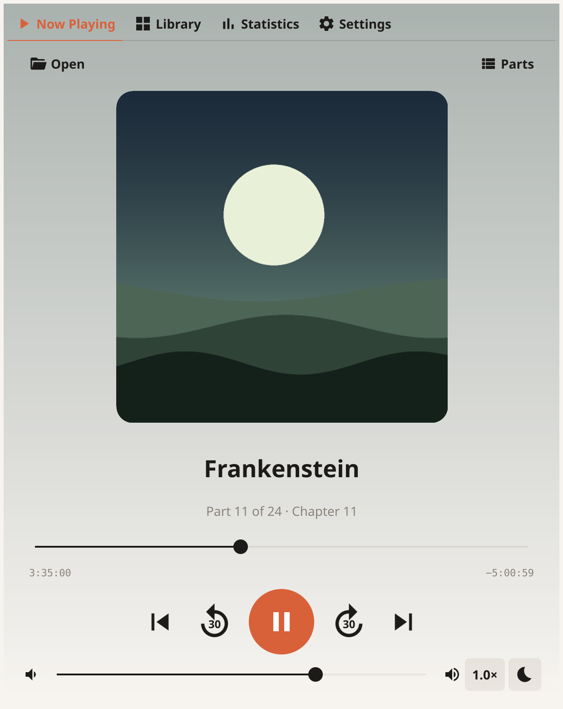
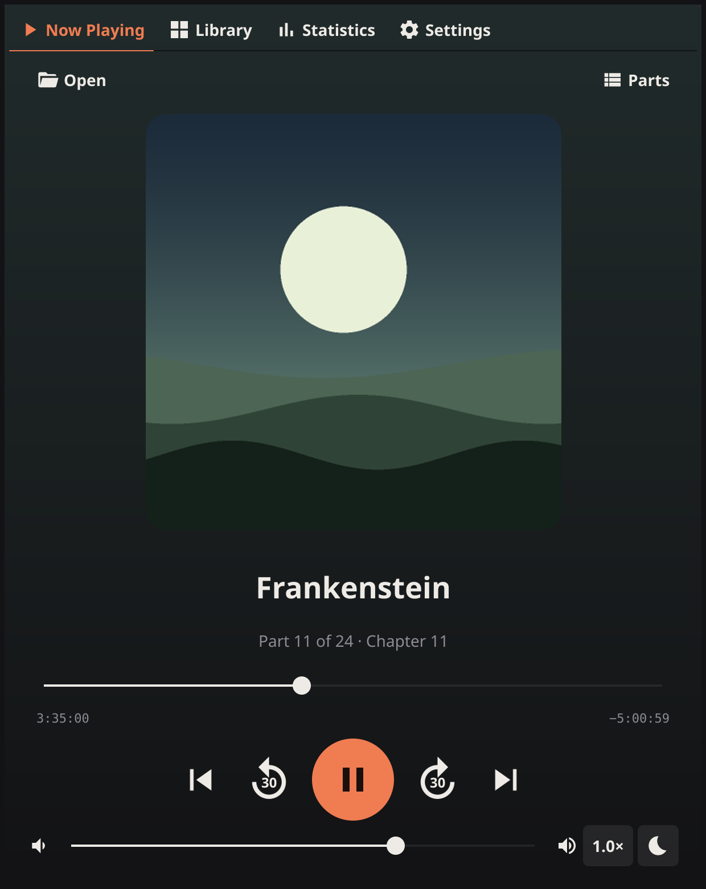
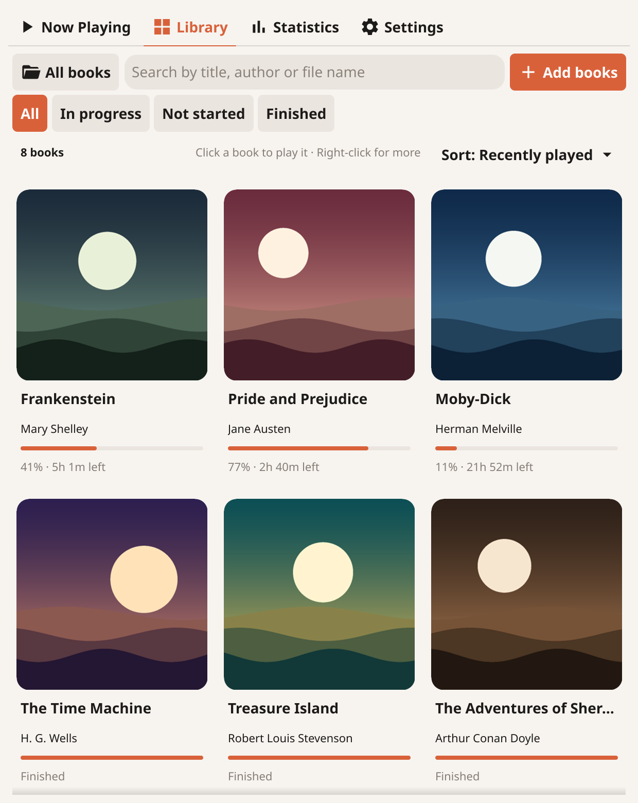
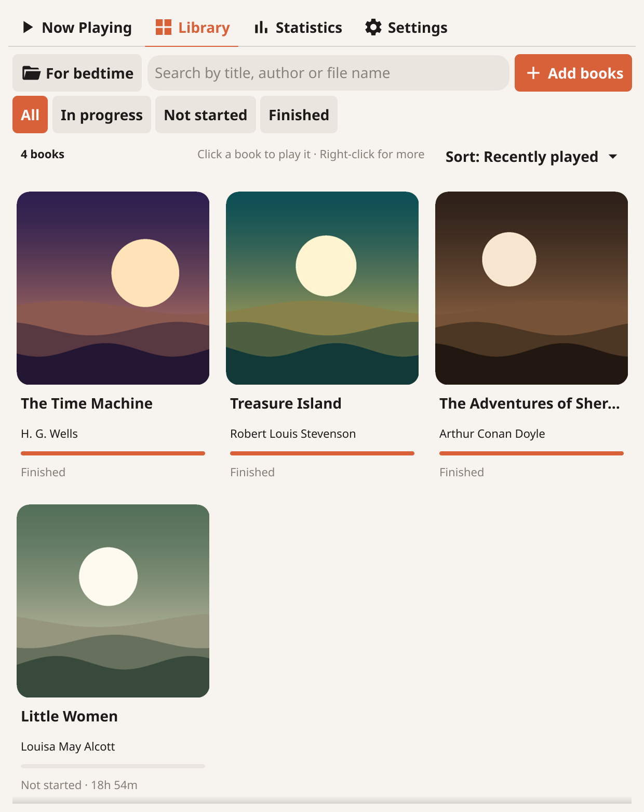
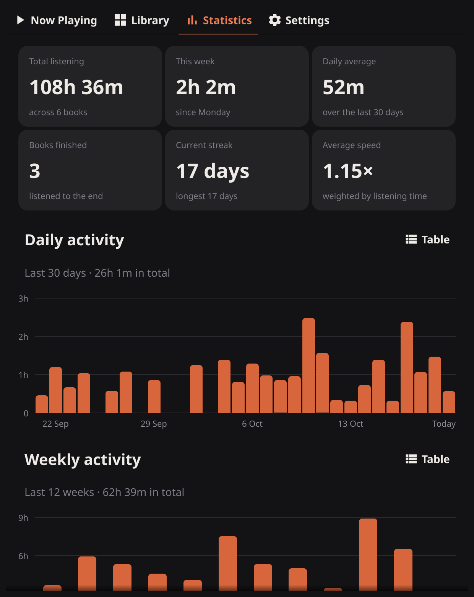

# Audiobook Player

A small desktop audiobook player for macOS and Windows (Linux works too), written in Go with [Fyne](https://fyne.io).

<p align="center">
  
  
</p>

## Features

- Plays **MP3, M4B, M4A, WAV, FLAC and Ogg Vorbis**.
- A **Library** of your audiobooks with cover art and how far you've got in each one, so you can switch books with one click. See [Library](#library).
- **Multi-part books**: open a folder and its files play in order (`Part 2` before `Part 10`). The next part starts automatically, and ⏮ / ⏭ and a **Parts** list let you jump between parts. Once the length of every part is known, the progress bar, times and 30-second skips cover the whole book.
- **Chapters in M4B, M4A and MP3 files**: ⏮ / ⏭ jump between chapters, a **Chapters** list shows each chapter with its start time, and the current chapter's title is shown while you listen.
- **Remembers your place in every book**, and resumes the last one when you reopen the app.
- Shows the book title, author and part names from the files' tags (ID3, FLAC and Vorbis comments), falling back to file and folder names.
- **Ratings and descriptions from Audible**, if you turn them on: each book's rating with how many people rated it, its description, narrator and release date. See [About this book](#about-this-book).
- **Edit details**: correct a book's title or author, or give it a cover image of your own, without renaming or retagging any files. See [Editing a book's details](#editing-a-books-details).
- **Speed from 0.5x to 2.0x** in 0.1x steps, without changing the pitch of the voice. **Each book remembers its own speed**: the speed you choose is kept for the book you're listening to, and books you haven't set a speed for use the speed you chose last. The time left, in Now Playing and on the Library cards, uses each book's own speed.
- Skip 30 seconds back or forward.
- **Goes back a little after a pause**, so you can pick up the thread: 2 seconds after a pause of a minute, 5 after five minutes, 10 after an hour, 20 after a few hours and 30 after a day or more, counting from when you last listened even if you closed the app in between. It doesn't go back if you moved somewhere yourself after pausing. Turn it off in **Settings → General → Playback**.
- **Sleep timer**: the moon button next to the speed stops playback after 5 to 90 minutes, at the **end of the chapter** (books with chapters) or at the **end of this part** (books of several parts). It shows the time left, taking the playback speed into account, only counts down while a book is playing, and fades the volume out over the last 10 seconds before pausing. Stopping at the end of a chapter or part leaves the book at the start of the next one, so pressing play carries straight on. If you skip into another chapter, the timer stops at the end of that one instead.
- Shows cover art: an image with the same name as the audio file, else artwork embedded in the file, else `cover`, `folder` or `front` `.jpg`/`.png`, else the first image in the folder.
- A warm light and dark look. It follows your system setting, or you can choose Light or Dark in **Settings**. The Now Playing screen is tinted with the colours of the book's cover. On Windows the title bar turns light or dark to match, and on Windows 11 the title bar and window border take the app's own colours.
- **Statistics**: total listening time, this week, daily average, books finished, listening streaks and average speed, with daily and weekly charts, a listening calendar and your most-listened books.
- **Collections** of your own, such as Currently reading, Classics or For bedtime. See [Collections](#collections).
- **Library folder**: choose a folder in **Settings** and the audiobooks in it are added to the library automatically, including ones you copy in later.
- **Media keys and system controls**: the play/pause and skip keys on your keyboard, headset buttons, and the media controls in Windows (taskbar, lock screen, the volume pop-up) and macOS (Control Center, the lock screen, AirPods) control the player and show the book's title and cover. See [Media keys](#media-keys-and-system-controls).
- Uses the native file picker on macOS and Windows. You can also drag a file or folder onto the window.

### Supported files

| Format | Notes |
|---|---|
| MP3 | |
| M4B, M4A | AAC-LC, mono and stereo (HE-AAC is not supported) |
| WAV | 8, 16 and 24-bit PCM (32-bit float is not supported) |
| FLAC | Any bit depth |
| Ogg Vorbis (`.ogg`, `.oga`) | Mono and stereo |

HE-AAC, Opus and copy-protected Audible (`.aa`, `.aax`) or Apple Books files are not supported.

Chapters are read from M4B and M4A files, from either a QuickTime chapter track (what Apple's tools and most converters write) or a Nero `chpl` box, and from MP3 files, from the ID3 `CHAP` frames that audiobook tools write (ID3 versions 2.3 and 2.4). ⏮ goes back to the start of the current chapter if you are more than 3 seconds into it, and to the previous chapter otherwise.

### Library

The **Library** tab shows every book you've added as a card with its cover, title, author and progress (for example `43% · 5h 12m left`, or `Finished`). The books you listened to most recently come first, unless you choose another order.

<p align="center">
  
  
</p>

- **Add books** lets you choose one or more folders. Every audiobook inside them is added, however deeply it is nested:
  - a folder of audio files is one book, and its files are the book's parts;
  - `.m4b` files are always books of their own, so a folder of `.m4b` files gives one book per file.
- You can also drop folders or files onto the Library tab.
- Any book you open with **Open file** or **Open folder** is added automatically. Opening one part of a book that's already in your library opens that book at that part.
- Each book is only added once, however you reach it. See [Duplicates](#duplicates).
- Click a book to carry on from where you stopped. Right-click a book to edit its details or to remove it from the library; neither touches the files. **Remove from library…** asks first, so a stray click can't take a book away.
- **Reset progress…**, in the same menu for a book you've started, puts it back at the beginning and clears its finished mark, after asking. If you sync between computers, the others start it from the beginning too. Your listening statistics are kept.
- Type in the search box (or press ⌘F on a Mac, Ctrl+F elsewhere) to find a book by its title, author, or file or folder name. Upper and lower case and accents don't matter, so `bronte` finds *Brontë*, and every word you type has to match.
- **All**, **In progress**, **Not started** and **Finished** above the books show only the books in that state. They work together with the search box, so **Finished** plus `tolkien` shows the Tolkien books you've finished.
- **Sort** orders the books by:
  - **Recently played**: the last book you listened to first;
  - **Title**: A to Z, ignoring case and accents, with `Book 2` before `Book 10`;
  - **Author**: A to Z by author, then by title. Books without an author come last;
  - **Progress**: books in progress first, furthest along first, then books you haven't started, then finished ones;
  - **Length**: shortest book first. Books whose length isn't known yet come last;
  - **Time left**: the book you're closest to finishing first, at each book's own speed. Finished books come last;
  - **Rating**: highest Audible rating first. Books rated by fewer than 100 people come after the others, so a 5.0 from three people doesn't top the list, and books without a rating come last.

  The order you choose is remembered. The filter always starts at **All**, so books never seem to be missing when you open the app.
- A book whose files have been moved or deleted shows `Not found`. A book on a drive or server that isn't connected, or isn't responding, shows `Not connected` and keeps your place, and it's picked up again when you come back to the Library once the drive or server is back.

#### Duplicates

Adding folders that overlap, such as `Audiobooks` and then `Audiobooks/Tolkien`, or the same folder through a shortcut or link, never puts a book in the library twice:

- A book reached by another path, or a single part of a book that's already in the library, isn't added again.
- If you opened one part of a book on its own and then add the whole folder, the part is folded into the book, along with your place, listening time, collections and edited details.
- A copy of a book that's already in your library from another folder (the same file names and sizes) isn't added by **Add books**, by dropping it on the Library, or by the library folder. The app tells you, and the library folder's status counts the skipped copies. If you added the book to a collection while doing this, the copy already in your library goes into the collection instead. If the first copy is later moved or deleted, the other copy takes its place, with your progress.
- A copy you open with **Open file** or **Open folder** is still added, because you asked for that one. When the library holds copies of the same book, a **duplicates** button appears next to the book count. It lists each book's copies with where they are and how far you've got, so you can remove the ones you don't need. Their files stay where they are.

#### About this book

Right-click a book and choose **About this book…**, or click **About** at the top of Now Playing, to see its Audible rating, how many people rated it, its description, narrator, release date and length.

- Audible look-ups are **off until you turn them on**, in **Settings → Ratings** or with the button in the About window. Choose your **Audible store** there too (United States, United Kingdom, Germany and others), because ratings differ between stores.
- Once look-ups are on, every book in your library is matched automatically in the background, one book every few seconds: the app searches Audible for its title and author and takes the first edition, the one most people rated, since its rating is the most reliable. If the book's files carry an Audible product number (ASIN), as many files bought from Audible do, that edition is used instead. Words like *(Unabridged)* are left out of the search, and a result is only used if its title shares a word with the book's, so a book called *Part 1* isn't matched to something unrelated.
- The rating then appears on the book's card, for example `★ 4.5 · 23k`. If the match is wrong, open **About this book** and choose **Change edition…** to pick another from the list, or **Not this book** to remove it; a book you've said *Not this book* to isn't matched automatically again. **Find on Audible…** searches by hand, and you can change the title and author before searching.
- A book Audible had nothing for is searched again after a month, or straight away if you correct its title or author with **Edit details**.
- Ratings from fewer than 100 people are marked as possibly unreliable.
- The details are saved on your computer and refreshed in the background once they're more than 30 days old.
- **What is sent:** each book's title and author, or its Audible product number, and only to the Audible store you picked. Nothing is sent while look-ups are off; the details already saved stay visible.
- This uses the same catalogue look-up that Audible's own apps and other audiobook players use. It isn't an official, documented service, so it may stop working if Audible changes it.

#### Editing a book's details

If a book's title or author is wrong, or it has no cover or the wrong one, right-click it in the Library and choose **Edit details…**, or click **Edit** at the top of Now Playing.

- Change the **Title** and **Author**, and press **Save**. The new details are used everywhere: the Library card, search, sorting, Now Playing, Statistics and the system's media controls.
- **Choose image…** picks a JPEG, PNG, GIF, BMP or WebP image to use as the cover. **Use original** goes back to the cover found with the book.
- Clear a field, or type back what the files say, to use the files' own details again.
- Search finds a book by its corrected details and by its original ones.
- Your audio files and folders are never changed. The details are kept in `library.json`, and a copy of each chosen cover in `covers/` (see [Your data](#your-data)), so the cover stays even if you delete the image you chose. Corrections follow books that move, like your progress does.

#### Collections

Collections are your own groups of books, such as **Currently reading**, **Classics** or **For bedtime**. A book can be in as many collections as you like, and its files stay where they are.

- The button at the top left of the Library shows where you are: **All books** or a collection. Its menu switches between them, makes a **New collection…**, and renames or deletes the collection you're in. Deleting a collection keeps its books in your library.
- Right-click a book and choose **Add to collection** to tick or untick the collections it's in, or to make a new one with it in. Inside a collection, **Remove from "Classics"** takes it out of just that collection.
- **Add books**, and dropping folders onto the Library, add the new books to the collection that's open.
- Search, the **In progress / Not started / Finished** filters and **Sort** all work inside a collection.
- Collections are saved in `library.json`, follow books that move, and drop books that have been deleted from the disk.

### Statistics

The **Statistics** tab shows how much you listen. Time is only counted while a book is actually playing, so it starts from when you first use this version.

<p align="center">
  
</p>

- **Total listening**, **This week** (since Monday) and **Daily average** (over the last 30 days) are real time spent listening, not book time, so listening at 1.5× for an hour counts as an hour.
- **Books finished** counts each book you have listened to the end, once.
- **Current streak** is the number of days in a row you have listened for at least a minute. Today only breaks the streak once it is over.
- **Average speed** is weighted by how long you listened at each speed.
- **Daily activity** (30 days) and **Weekly activity** (12 weeks) are bar charts; hover over a bar to see its value. The **Listening calendar** shows the last 26 weeks, one square per day, darker for more listening (lighter in dark mode).
- Every chart has a **Table** button that shows the same numbers as a list.

#### Library folder

In **Settings → Library → Library folder** you can choose the folder where you keep your audiobooks. Every book in it is added to the library, using the same rules as **Add books**, and the folder is checked again:

- when the app starts and when you choose the folder,
- when you open the Library tab (at most every 30 seconds, or every 2 minutes for a folder on a server),
- every 2 minutes while the app is open (every 10 minutes for a folder on a server), and
- when you click **Check now**.

System folders are skipped: hidden folders, Synology's `#recycle`, `#snapshot` and `@eaDir` folders, and Windows' `$RECYCLE.BIN` and `System Volume Information`. So books in a NAS's recycle bin or snapshots aren't added.

Checks are quick even for a big library on a server: a folder is only read again when something in it was added, removed or renamed, so an unchanged library costs one look at each folder. **Check now** reads everything again. A book whose files changed in the last 30 seconds is left until the next check, so a book that is still being copied isn't added half-finished. If a book gets a new part, its card is updated. Books you remove from the library aren't added again; adding one by hand brings it back. **Stop importing** turns this off and leaves the books already in your library where they are.

#### Books on a NAS or network share

You can keep your audiobooks on a NAS, such as a Synology, or any computer that shares folders over SMB, and listen from it at home or away. The easiest way is to let the app connect by itself, with nothing to set up in Finder, File Explorer or a VPN app:

1. Share the folder over SMB. On a Synology this is on by default (**Control Panel → File Services**).
2. In **Settings → Server & sync → Media server**, enter the server's address (for example `192.168.1.10`), the shared folder's name (for example `audiobooks`), optionally a folder inside it (for example `Books`), and the username and password for the server. To listen away from home, also **Import WireGuard file…**: the `.conf` file your WireGuard server gives you for this computer.
3. Click **Connect**, then **Use as library folder**, and **Sync through it** if you want your place synced between computers.

At home the app connects to the server directly. When it can't, for example when you're away, it connects through WireGuard by itself. The tunnel runs inside the app, only for the app's own connection to the server: there's no VPN app to install, no administrator permission, and the rest of the computer's traffic isn't affected. The status line says whether it's connected *on your home network* or *through WireGuard*, or what's wrong, such as a wrong password or shared folder name, and the app keeps trying in the background.

The password and the WireGuard key are kept in the computer's keychain (Keychain on macOS, Credential Manager on Windows, the Secret Service on Linux), never in the app's files. To set up another computer, use **Export connection file…** and open the file with **Import connection file…** there; only the password has to be entered again. The file contains the WireGuard key, so keep it private.

You can also connect to the share yourself and choose it as an ordinary folder: on a Mac, **Finder → Go → Connect to Server** with `smb://` and the server's address, for example `smb://10.0.0.5/audiobooks`; on Windows, **Map network drive** with `\\10.0.0.5\audiobooks`; then choose it in **Settings → Library → Library folder**.

Books play straight from the share. Covers and part lengths are remembered on your computer, so the Library opens without reading every book over the network. When the VPN is off or the NAS is asleep, nothing freezes the window: books show `Not connected`, the library folder's status says the folder isn't available or isn't responding, and nothing about your books is forgotten.

Opening a book never freezes the window: Now Playing says *Opening…* until it's ready, and pressing play meanwhile starts it as soon as it is. MP3 parts start playing after reading only their first few kilobytes, however long they are, and jumping around reads only a little more: in constant-bitrate files, which most audiobooks are, a jump lands exactly where you asked; in variable-bitrate files it uses the index the encoder stored in the file and lands within a fraction of a second (a few seconds at most in very long parts). Rare variable-bitrate MP3s without that index are still read once in full before they play. While you listen, the next part is opened in the background before the current one ends, so moving on to it is instant. Downloading a book for offline listening makes it open straight away.

While a book plays, the app reads up to 20 seconds ahead, so short drop-outs in the connection aren't heard at all. If the connection stays down longer, playback goes quiet and Now Playing says *Waiting for the drive or server…*. It carries on by itself when the connection comes back, or stops with a message if your computer gives up on the server.

#### Offline listening

To listen to a book on your NAS without the network or VPN, for example while travelling, right-click it and choose **Download for offline listening**. A copy is kept on your computer:

- The book downloads in the background, and its card shows how far it has got (`Downloading 45%`), then `Downloaded`. **Cancel download** stops it and deletes what was copied.
- A downloaded book always plays from the copy on your computer, even when the NAS is there, so it starts quickly and doesn't use the network. It's still the same book: your place, statistics, edited details, Audible match and sync all carry on as before.
- If the connection drops while downloading, the download pauses (`Download paused`) and carries on by itself when the NAS is back, without copying the finished parts again. A part is only used once it has been copied completely.
- If the book changes on the NAS, such as a part being added, its card says `Download out of date` and the menu offers **Update download**.
- The app checks there's enough space before downloading, and tells you if there isn't.
- **Remove download** deletes the copy on your computer; the book on the NAS is never touched. Removing a book from the library deletes its copy too.
- **Settings → Library → Offline downloads** shows how many books are downloaded and how much space they use, and has **Remove all downloads**. Turn on **Keep the book I'm listening to downloaded** to have the book you open downloaded automatically (books on a server only). When you open another book, the previous automatic download is removed, so only one is kept.

#### Sync between computers

To carry on a book on another computer where you stopped on this one, choose the same folder in **Settings → Server & sync → Sync between computers** on each computer: a folder on your NAS, or one kept in step by Synology Drive, iCloud Drive, Dropbox or OneDrive. The books themselves need to be on each computer, or on the NAS.

- Each computer saves its place in every book to its own file in that folder, in a hidden `.audiobook-player-sync` folder, so two computers never write the same file. It saves when you pause, every minute while you listen, and when you quit.
- It reads the other computers' places when the app starts, when you switch back to it, every minute, and when you click **Sync now**.
- Books are matched by their files' names and sizes, not their folders, so it doesn't matter where each computer keeps them. If one computer has different files for the same book, such as a re-encoded copy, your place is matched by the time into the book instead.
- The most recent listen wins. Only listening counts, along with moving around the book yourself (skipping, choosing a chapter or part, or resetting it); just opening a book doesn't, so opening it on a second computer straight after listening on the first still offers the first one's place. When you start the app, it opens the book you were listening to last on any computer.
- If the book you have open was listened to further on another computer, the app asks first: *Continue from 3:35:00? You listened to “Dune” on MacBook 10 minutes ago.* Choose **Jump there** or **Stay here**; it never moves your place while you're listening.
- When the folder can't be reached, for example with the VPN off, your place is kept on this computer and synced once the folder is back.
- Besides your place, these are synced too:
  - **edited details**: corrected titles and authors, custom covers (the image is copied through the sync folder), each book's own speed and its Audible match with its rating and description. The most recent change to a book wins, and clearing a correction clears it everywhere;
  - **collections**: new, renamed and deleted collections and which books are in them. The most recent change to a collection wins. Books in a collection that one computer doesn't have are kept, so they're still there when the collection comes back to the computer that has them. Collections with the same name made on two computers become one;
  - **listening statistics**: each computer keeps counting its own listening, and **Statistics** adds up all your computers, so time, streaks, finished books and your most-listened books cover everything without counting anything twice.
- Changes are written to the sync folder within a few seconds of making them.

Progress needs the length of every part. For most files, including MP3s, this comes from the start of the file, so adding a book is quick even over a network. Variable-bitrate MP3s without an index have to be read once in full, which happens in the background the first time the book is added. The lengths are remembered after that.

### Your data

Everything the app remembers stays on your computer, in the app's folder. The only things that ever leave it are a search to Audible, if you turn [Audible look-ups](#about-this-book) on, and your place in each book, written to the sync folder you choose if you turn on [syncing between computers](#sync-between-computers):

| System | Folder |
|---|---|
| Windows | `%APPDATA%\fyne\com.izzzicos.audiobookplayer\Data` |
| macOS | `~/Library/Preferences/fyne/com.izzzicos.audiobookplayer/Data` |
| Linux | `~/.config/fyne/com.izzzicos.audiobookplayer/Data` |

`preferences.json`, with your settings, is one level up, where Fyne keeps it. Earlier versions kept everything in that upper folder; the files are moved into `Data` the first time this version starts.

- `library.json` holds your library, where you are in each book and your listening statistics. It is saved by writing a complete new copy and then swapping it in, so a crash or power cut while saving can't leave a half-written file.
- `backups/` keeps a copy of `library.json` from each of the last 7 days. If `library.json` is ever unreadable, the app restores the newest good backup and tells you. If there is no backup, it keeps the damaged file aside instead of overwriting it.
- `covers/` holds copies of the covers you chose with **Edit details…**, scaled down to at most 1200 pixels.
- `scan-cache.json` remembers what the library folder holds, so the first check after starting the app only reads folders that changed.
- `shelf-cache.json` and `thumbnails/` remember each book's title, author and a small copy of its cover, so the Library opens quickly instead of reading every book's tags and full-size cover each time. A book is read again as soon as its first audio file, its folder or its cover image changes. Books that leave the library are dropped from the cache when the app starts. The cache can be deleted at any time; it is rebuilt the next time the app opens.
- `offline/` holds the books you've downloaded for offline listening. **Settings → Library → Offline downloads** shows how much space they use and can remove them all.
- Your sync folder, if you choose one, holds a small file per computer with its place in each book. Nothing else is written there.
- `online.json` holds the Audible details of the books you've matched. Which edition each book is matched to is kept in `library.json`, so it's backed up with the rest of your library.
- `preferences.json` holds your settings (volume, speed, appearance, library folder, Audible look-ups and store).

`library.json` doesn't grow forever. Each time the app starts it tidies up:

- **Part lengths** are forgotten for files that were deleted or changed, and for books no longer in the library. A book whose drive isn't connected keeps them, so it doesn't have to be measured again when the drive comes back.
- **Removed books** that have also been deleted from the disk lose their saved place. A removed book that is still on the disk, or on a drive that isn't connected, is remembered, so it isn't imported again.
- **Edited details** of books that have been deleted from the disk are forgotten, along with any covers nothing uses any more.
- **Daily statistics** older than a year are folded into one summary. Total listening time, average speed and listening streaks stay exactly the same; the charts only show the last 26 weeks anyway. Each book's listening time and finished books are kept, because **Most listened** and **Books finished** use them.

To move to a new computer, copy the whole `com.izzzicos.audiobookplayer` folder. Books that end up somewhere else are found again automatically (see below).

Data from earlier versions, which kept everything in `preferences.json`, is moved into `library.json` the first time the new version starts.

### Moved books

The app remembers each book by its files' names and sizes as well as its location, so moving books doesn't lose your progress, statistics or finished books:

- If a drive gets a different letter on Windows (for example a USB drive that was `E:` and is now `F:`), books and the library folder are found on the new letter.
- If you choose a new library folder after moving the old one, books are matched up by where they were inside it.
- If a book shows **Not found** and is then found by the library folder or **Add books** somewhere else, it is reconnected instead of being added a second time. This works even if the book's folder was renamed or a part was added.

### Opening files and running once

Only one copy of the app runs at a time. Starting it again, or opening an audiobook with it, brings the open window to the front instead. A file or folder passed on the command line (`"Audiobook Player.exe" "D:\Books\Dune.m4b"`) opens in the player, which is what Windows' **Open with** and file associations use.

### Media keys and system controls

The book you're listening to is shown in the system's media controls with its title, author and cover, and these all work while the app is in the background:

| Button | Action |
|---|---|
| Play, pause, play/pause | Play or pause |
| Next, skip forward | Forward 30 seconds |
| Previous, skip back | Back 30 seconds |
| Dragging the position (macOS) | Moves to that point in the book |

Next and previous skip 30 seconds rather than jumping to the next chapter, as most audiobook players do, so a headset's double press doesn't lose your place. On macOS, Control Center shows 30-second skip buttons and a position bar for the whole book. Windows shows the title, author and cover, and play/pause, previous and next buttons.

### Keyboard shortcuts

| Key | Action |
|---|---|
| Space | Play / pause |
| ← / → | Back / forward 30 seconds |
| ↑ / ↓ | Volume up / down |
| ⌘F / Ctrl+F | Search the library |

## Running from source

You need [Go 1.27 or newer](https://go.dev/dl/) and a C compiler, because Fyne uses OpenGL through cgo. With an older Go (1.21 or later) installed, `go` downloads 1.27 for you the first time you build.

**macOS**

```sh
xcode-select --install
go run .
```

**Windows**

1. Install Go.
2. Install a C compiler, for example the MinGW-w64 toolchain from [MSYS2](https://www.msys2.org/). Follow Fyne's [Windows setup guide](https://docs.fyne.io/started/#windows) and make sure `gcc` is on your `PATH`.
3. Run:

```powershell
go run .
```

**Linux (Debian or Ubuntu)**

```sh
sudo apt install gcc libgl1-mesa-dev xorg-dev libasound2-dev
go run .
```

On Linux the native file picker needs `zenity` or `kdialog`. If neither is installed, the app uses Fyne's own file browser.

The media server connection has tests against a real SMB server, which only run when asked for. With Docker, start a throwaway Samba server and run them with the `smbserver` tag:

```sh
docker run -d --name abp-smb-test -p 127.0.0.1:1445:445 dperson/samba -u "tester;secret" -s "audiobooks;/share;yes;no;no;tester"
docker exec abp-smb-test sh -c 'mkdir -p "/share/Books/Tolkien/The Hobbit" /share/Books/Herbert'
docker cp "audio/testdata/speech-16bit-mono.wav" "abp-smb-test:/share/Books/Tolkien/The Hobbit/Part 1.wav"
docker cp "audio/testdata/speech-24bit-stereo.flac" "abp-smb-test:/share/Books/Tolkien/The Hobbit/Part 2.flac"
docker cp "audio/testdata/speech-aac-mono.m4b" "abp-smb-test:/share/Books/Herbert/Dune.m4b"
docker exec abp-smb-test chown -R smbuser:smb /share
go test -tags smbserver ./mediaserver/ ./ui/
docker rm -f abp-smb-test
```

## Building an app to share

`go build .` produces a plain executable. To get a proper app with its name and icon (`Audiobook Player.app` on macOS, `Audiobook Player.exe` on Windows), use Fyne's packaging tool. It reads `FyneApp.toml` and `Icon.png`:

```sh
go install fyne.io/tools/cmd/fyne@v1.7.3
fyne package -os darwin -release     # run on a Mac
fyne package -os windows -release    # run on Windows
```

Each package must be built on its own platform. To build for Windows from a Mac, use [fyne-cross](https://github.com/fyne-io/fyne-cross), which requires Docker.

### Windows installer

`packaging/windows/AudiobookPlayer.iss` is an [Inno Setup](https://jrsoftware.org/isinfo.php) script that turns `Audiobook Player.exe` into `dist\AudiobookPlayerSetup-<version>.exe`. The installer:

- installs for the current user without asking for administrator rights (or for everyone, if you choose),
- adds a Start menu entry and, if you tick it, a desktop shortcut,
- adds the app to **Open with** for `.m4b`, `.m4a`, `.mp3`, `.flac`, `.ogg`, `.oga` and `.wav` files, and to **Settings → Apps → Default apps**. Windows doesn't let installers make themselves the default. The first time you open a `.m4b` file, which usually has no other app, Windows suggests Audiobook Player,
- closes the app if it's running when you update, and
- leaves your library and settings behind when you uninstall.

On Windows, after `fyne package -os windows -release`:

```powershell
& "C:\Program Files (x86)\Inno Setup 6\ISCC.exe" /DAppVersion=1.0.0 packaging\windows\AudiobookPlayer.iss
```

### Automatic builds

`.github/workflows/build.yml` runs on GitHub Actions for every push and pull request:

1. **Tests** run on Windows and macOS (`go vet` and `go test`, with the race detector on macOS). This includes a test that registers with Windows' media controls for real. It skips itself on a Windows without them.
2. **Windows installer**: for pushes, the app is packaged and the installer built. You can download it from the run's **Artifacts**.
3. **Releases**: pushing a tag such as `v1.2.0` builds the installer with that version and attaches it to a new GitHub release:

```sh
git tag v1.2.0
git push origin v1.2.0
```

### Code signing

Without a signature, Windows SmartScreen warns that the installer is from an "unrecognised app", and users have to click **More info → Run anyway**. The workflow signs the app and the installer with [Azure Artifact Signing](https://learn.microsoft.com/azure/artifact-signing/) (formerly Trusted Signing) when it's set up, and skips signing when it isn't:

1. Create an Artifact Signing account, complete identity validation and create a certificate profile.
2. Create an app registration in Microsoft Entra ID with a client secret, and give it the **Artifact Signing Certificate Profile Signer** role on the account.
3. In the GitHub repository, under **Settings → Secrets and variables → Actions**, add:
   - secrets `AZURE_TENANT_ID`, `AZURE_CLIENT_ID` and `AZURE_CLIENT_SECRET`,
   - variables `SIGNING_ENDPOINT` (for example `https://weu.codesigning.azure.net/`), `SIGNING_ACCOUNT` and `SIGNING_PROFILE`.

A signature shows your verified name as the publisher straight away. SmartScreen's warning itself goes away once enough people have downloaded the signed app; no certificate skips that step any more.

## Project layout

```
main.go          starts the app and embeds the icon
docs/
  screenshots/   the pictures in this README
FyneApp.toml     app name, ID and version used by `fyne package`
audio/           playback: Player, decoders for each format, pitch-preserving speed changer
library/         books on disk: Book, folder scanning and sorting, tags, chapters, cover art, display names
stats/           listening statistics: recording, totals, streaks
store/           crash-safe saving, daily backups and recovery
instance/        making sure only one copy of the app runs
media/           media keys and the system's media controls (Windows, macOS)
titlebar/        a light or dark Windows title bar to match the app
packaging/
  windows/       the Inno Setup installer script and the Windows icon
.github/
  workflows/     tests on Windows and macOS, the Windows installer and releases
ui/              the window: creates the parts below and connects them
  app.go           start-up, loading and saving, opening files from the command line
  window.go        the tabs, drag and drop, keyboard shortcuts, the timers
  nowplaying/      the Now Playing tab: playback, parts and chapters, sleep timer, media keys, Open
  shelf/           the Library tab: cards, collections, search, sort and filter, adding and removing, moved books
  autoimport/      the library folder: checking it for new books, its section in Settings
  statistics/      the Statistics tab and its charts
  settings/        the Settings tab: Light / Dark and the Windows title bar
  userdata/        library.json: positions, part lengths, statistics, removed books, older versions
  kit/             shared look: colours, icons, time formats, headings, menus, file pickers
  internal/
    testbooks/     sample books for the tests
```

`audio` and `library` don't depend on the UI, so they can be tested without opening a window.

Each part of `ui` keeps its widgets and state private, and the parts don't use each other's internals. `ui` gives each part what it needs: the saved data (`userdata`), or a small named function such as the library's `Open` (play this book) and `Show` (show the Library tab). So changing how one tab works can only affect another tab through those functions. Only `ui` itself needs a C compiler, so the other parts can be checked for Windows from a Mac, for example `GOOS=windows CGO_ENABLED=0 go vet ./ui/shelf/ ./ui/nowplaying/`.

## Tests

```sh
go test ./...
```

Small sample audio files for the decoder tests are in `audio/testdata` (see the README there for their sources).

### Screenshots

The pictures in this README are drawn by the app itself, from a demo library of public-domain books with made-up cover art and listening history. After changing how the app looks, update them with:

```sh
go test -tags screenshots -run TestScreenshots ./ui/
```

This writes `docs/screenshots/*.png`. The generator is in `ui/screenshots_test.go`, and normal test runs skip it.
